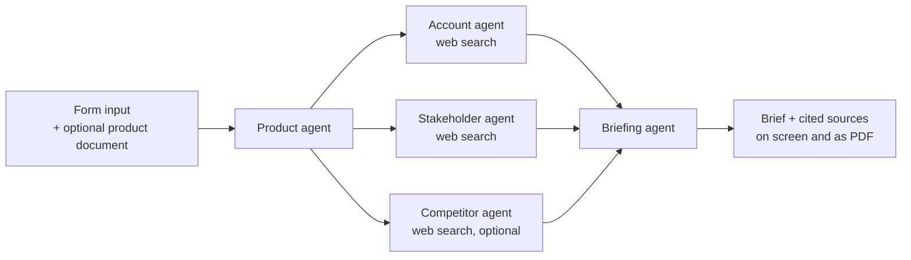

# Architecture

Sales Agent turns a few form fields into a one-page meeting brief. Five agents, each a single Claude call with its own role and task, run as a short pipeline. Three of them research the web in parallel.



## Agents

| Agent | Searches the web | Input | Output |
|---|---|---|---|
| Product | No | Product name, category, value proposition, text from the uploaded document | A short summary of what is being sold |
| Account | Yes | Account website, product summary | The company, its priorities and recent moves, buying signals |
| Stakeholder | Yes | Account website, who the meeting is with, product summary | The contact's remit, other decision makers, their recent public statements |
| Competitor | Yes (only if competitors are given) | Competitor websites, product summary, account | Positioning of each competitor against the product, any sign the account uses one |
| Briefing | No | All research notes | The final brief with talking points |

The three research agents depend only on the product summary, so they run concurrently with `asyncio.gather`. The briefing agent is told to use only the research notes, so it can't add unsourced facts.

## Sources

The research agents use Anthropic's server-side web search tool. Claude attaches citations to the sentences it writes from search results, and `src/core/llm.py` collects the cited pages. The source list at the end of the brief is built from those citations, never written by the model, so every entry is a page that was actually read.

## Code layout

```
app.py                  Streamlit entry point and page routing
src/core/brief.py       AccountBrief: the user's input and its validation
src/core/documents.py   Text extraction from PDF, DOCX, PPTX and TXT
src/core/llm.py         Claude client: one call per agent, web search, citations, refusal handling
src/core/pipeline.py    Runs the agents and assembles the report
src/agents/             The five agents (role, prompt, whether they search)
src/pages/              The landing page and the brief form
```

## Model

The agents run on Claude Sonnet 5.5 (`claude-sonnet-5-5`) by default; set `ANTHROPIC_MODEL` to use another model. Research agents run at medium effort, the product summary at low and the final brief at high. Requests opt in to server-side fallback, so a safety decline is retried on a fallback model within the same call.
